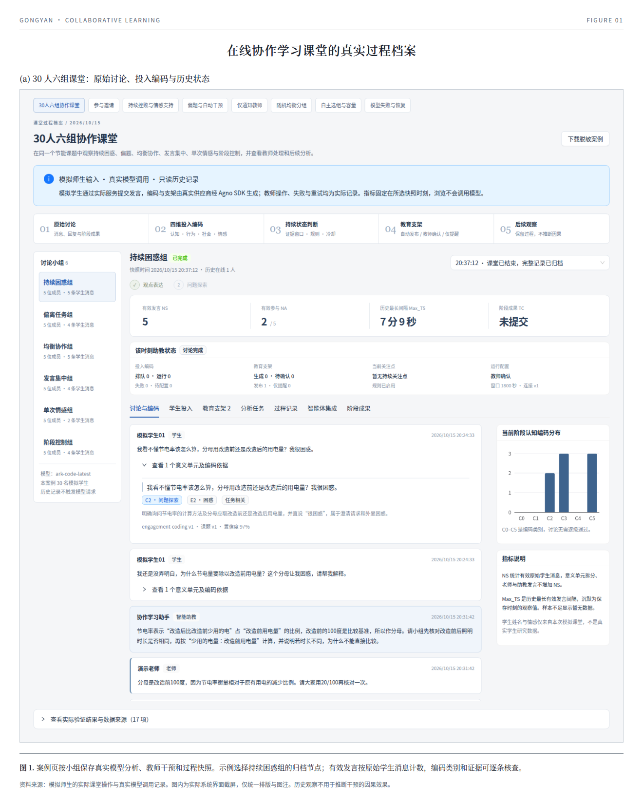
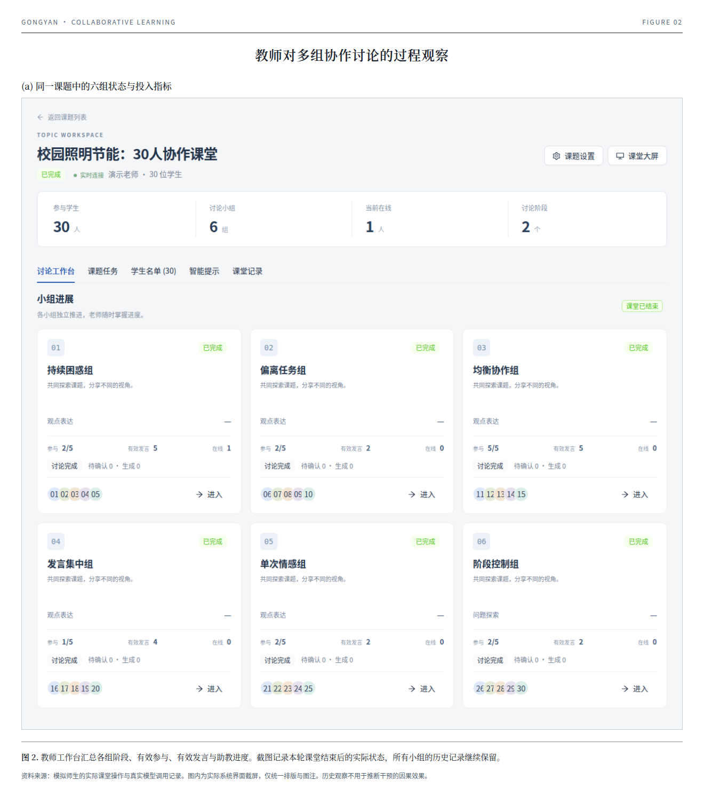
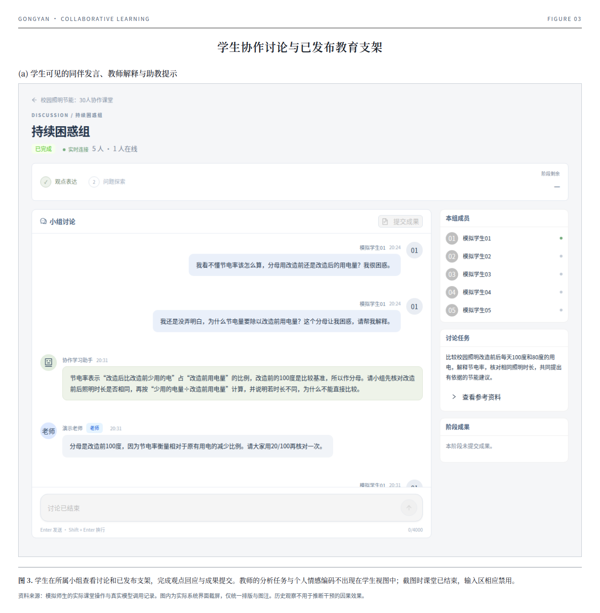
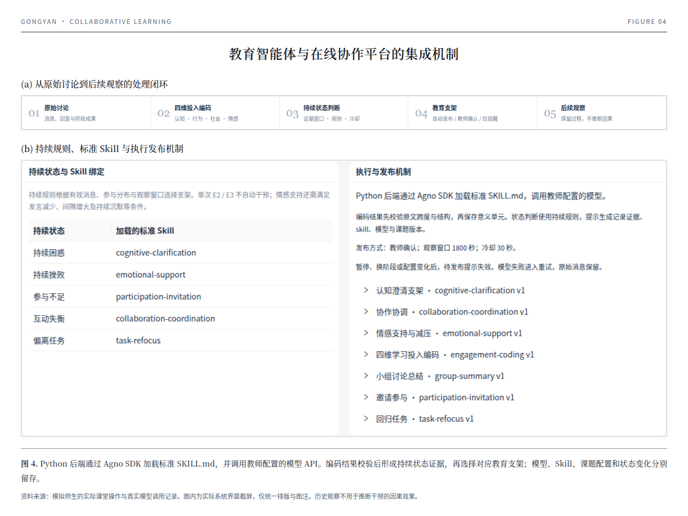
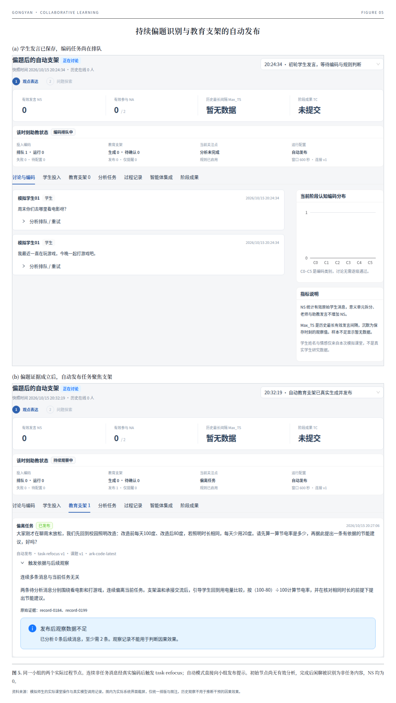
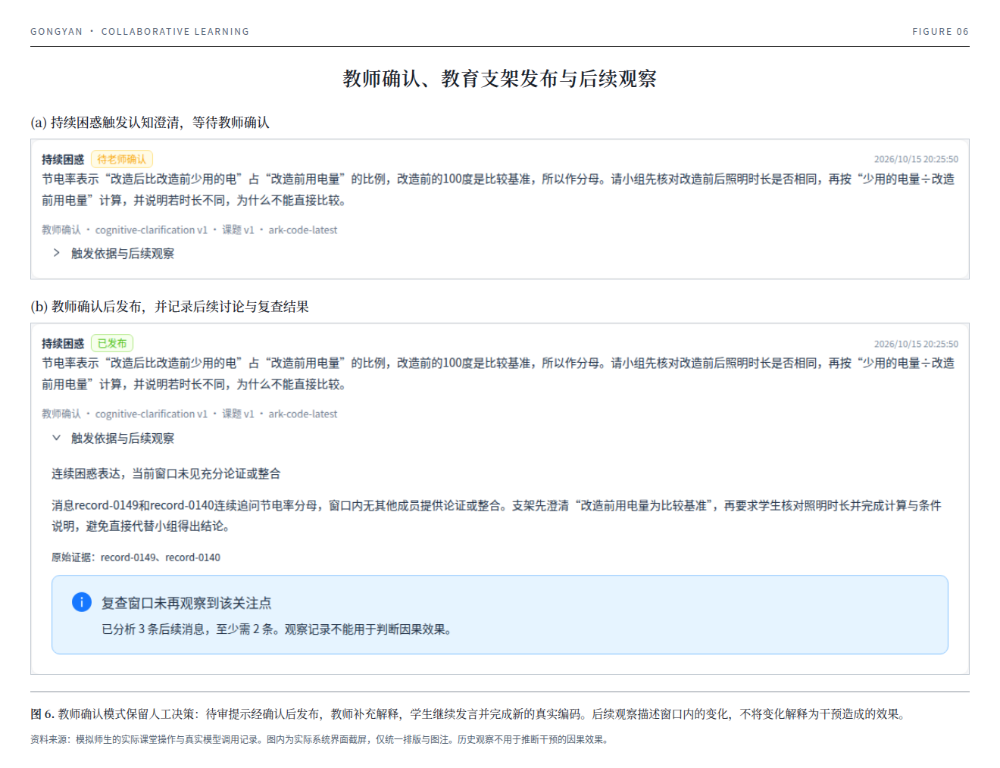

# 共研 · 在线课堂协作学习

面向 30–60 人课堂的在线讨论平台。老师创建课题、组织分组、查看讨论和投屏；学生加入课题、参与讨论并提交成果。

## 环境准备

- [uv](https://docs.astral.sh/uv/getting-started/installation/)，用于管理 Python 和项目依赖。
- Python 3.12 或更新版本，也可由 uv 自动准备。
- Node.js 22 或更新版本，仅首次构建和更新网页时需要。
- 首次启动需要联网下载依赖。

以下命令以 Linux 环境为例，均在项目目录执行。平台默认使用 SQLite WAL，无需安装数据库服务。

### 安装 uv

Linux / macOS 在终端执行：

```bash
curl -LsSf https://astral.sh/uv/install.sh | sh
```

Windows 在 PowerShell 中执行：

```powershell
powershell -ExecutionPolicy ByPass -c "irm https://astral.sh/uv/install.ps1 | iex"
```

安装完成后重新打开终端，确认命令可用：

```bash
uv --version
```

如果提示找不到 `uv`，按安装脚本的提示将安装目录加入 `PATH`，再打开终端。其他安装方式见 [uv 官方安装说明](https://docs.astral.sh/uv/getting-started/installation/)。

### 准备 Python

已有 Python 3.12 或更新版本时可直接继续。未安装 Python 时，后续 `uv sync` 会自动下载适用版本，也可以先执行：

```bash
uv python install 3.12
```

## 启动服务

```bash
uv sync
uv run python scripts/quickstart.py
```

`uv sync` 自动创建项目的 `.venv`，只安装运行依赖。启动命令首次构建网页并生成 `data/config.json`。启动后打开 **http://localhost:8088**。

项目已有 `pyproject.toml` 和 `uv.lock`，直接执行上述命令即可。后续 Python 命令统一通过 `uv run` 执行，由 uv 使用项目虚拟环境，无需手动激活或全局安装依赖。可用 `uv run python --version` 查看实际使用的 Python 版本。命令说明见 [uv 项目使用指南](https://docs.astral.sh/uv/guides/projects/)。

依赖通过 `pyproject.toml` 中的国内镜像下载，uv 自动管理版本和环境，无需手动安装 Python 包。

再次执行相同命令即可启动，已有账号、课堂和配置会保留。按 `Ctrl+C` 停止服务。更新项目文件后执行：

```bash
uv sync
uv run python scripts/quickstart.py --update
```

### 让学生通过局域网访问

1. 在 `data/config.json` 的 `allowed_origins` 中保留已有地址，并追加服务器的实际访问地址，例如 `http://192.168.1.100:8088`，多个地址用逗号分隔。
2. 启动服务：

```bash
uv run python scripts/quickstart.py --host 0.0.0.0
```

学生使用浏览器访问 **http://服务器IP:8088**。需要其他端口时添加 `--port 8090`，同时在 `allowed_origins` 中配置对应地址和端口。

### 查看真实模型课堂案例

正常启动后，点击登录页的“先看看一堂课如何展开”，或直接打开 **http://localhost:8088/examples**。无需注册、供应商文件或模型密钥，即可查看内置案例；登录后也可从侧栏“课堂案例”进入。

案例包含 30 名模拟学生的六组协作课堂，以及参与邀请、情感支持、自动干预、仅通知、随机分组、自主选组和模型恢复等 8 个课堂案例，共 70 个历史快照。学生发言是模拟输入，投入编码与教育支架来自真实模型调用。

选择案例和小组后，通过右上方“过程快照”查看不同时刻的原文、编码依据、学生投入、支架、任务、教师操作与阶段成果；点击“下载脱敏案例”可保存对应记录。浏览历史案例不会调用模型，也不会写入自己的课堂。要组织新课堂，请按下文注册老师和学生账号。



## 注册与登录

在登录页点击“创建账号”。账号使用 3–80 位字母、数字、点、@、下划线或短横线，密码长度为 8–128 位。

**学生：** 选择“我是学生”，填写姓名、账号和密码，点击“创建账号”。无需邀请码，注册后进入学习空间。

**老师：** 选择“我是老师”，填写姓名、账号、密码和“老师邀请码”。邀请码由平台管理员从 `data/config.json` 的 `teacher_invite_code` 中获取并提供。

已有账号直接登录，系统根据账号身份进入老师或学生空间。退出时打开账号菜单，选择“退出登录”。

## 老师使用

1. 点击“创建课题”，填写主题、讨论任务、参考材料、阶段和时间，选择分组方式。
2. 分享课题码或加入链接，等待学生加入。
3. 在“管理分组”中组织学生：手动分配成员、生成并应用随机分组，或创建小组让学生自主选择。
4. 所有学生完成分组、每组至少一人后，点击“开始课堂”。
5. 进入小组查看消息、成员在线情况、阶段成果和学习投入；按需要暂停、恢复、推进阶段或结束讨论。
6. 打开“课堂大屏”投屏，或导出讨论记录。

倒计时结束后由老师决定是否推进阶段。课堂开始前可调整分组和移出误加入的学生；开始后成员与分组方式固定。



## 学生使用

1. 登录后点击“加入课题”，输入老师提供的 6 位课题码，也可以打开加入链接。
2. 等待老师分组；自主选组的课题可以选择合适的小组。
3. 老师开始课堂后，点击“进入我的小组”，发送观点、回复同伴并参与讨论。
4. 形成结论后点击“提交成果”，保存当前阶段的共同成果。



## 配置智能助教

老师进入“智能助教设置 → 模型连接”，填写兼容 OpenAI 的 API 地址和密钥，点击“获取模型”选择模型，也可手动填写模型 ID。点击“测试连接”验证当前填写的配置，成功后启用并保存。模型需要支持工具调用和 JSON 输出；无鉴权的本地模型密钥可填 `local-model`。更换 API 地址时需重新填写密钥。

火山 Coding Plan 使用 `https://ark.cn-beijing.volces.com/api/coding/v3`，输入以 `/api/coding` 结尾的地址时会自动补全。模型目录可能包含当前套餐不可调用的基础模型，可先使用套餐别名 `ark-code-latest` 并测试连接。

思考型模型分析较慢时，可将请求超时调为 120–180 秒。分析在后台执行，学生可以继续讨论。

在“Skills”中可编辑、新建或下载助教能力。进入课题设置，为不同讨论情况选择能力，并决定自动发布、老师确认或只提醒老师。

未配置模型时，学生仍可正常讨论。密钥保存在服务端，保存后页面不会显示原值。

### 教育智能体与平台集成

Python 后端通过 Agno SDK 加载标准 `SKILL.md`，将当前课题、阶段、学生原始消息与必要上下文交给教师配置的模型。结果通过结构与原文跨度校验后，保存为认知、行为、社会、情感四个维度的学习投入记录。

规则根据观察窗口内的持续证据选择认知澄清、参与邀请、协作协调、情感支持或任务聚焦能力；教师还可以手动请求阶段总结。原始消息、意义单元、模型与 Skill 版本、课题配置和状态变化分别保留，便于查看每次提示的来源。



### 自动干预与教师确认

在课题设置中选择发布方式：

| 方式 | 符合持续条件后的行为 |
| --- | --- |
| 自动发布 | 生成教育支架并发送到对应小组 |
| 教师确认 | 先生成待审提示，老师可确认发布或忽略 |
| 仅提醒老师 | 保留关注点与依据，不生成学生可见的提示 |

单次困惑或负面表达不会直接触发情感干预；情感支持还需要持续表达和参与变化等证据。C0–C5 是认知编码类别，不是学生必须依次通过的讨论阶段。暂停、换阶段或配置变化后，旧提示会失效，避免向学生发送过期引导。



发布后继续观察新发言：数据不足时保留“暂无充分观察”的状态；观察充足时记录当前窗口是否仍存在关注点。该记录用于教师了解讨论进展，不能据此判断干预的因果效果。模型调用失败时保留原文和失败记录，可以更正配置后重试。



图版、原始界面截图及排版源文件统一放在 [assets/screenshots](assets/screenshots/README.md)，便于查看和引用。

## 配置与数据保存

`data/` 保存本地配置和课堂记录。老师邀请码、访问地址等设置在 `data/config.json` 中，修改后重启服务生效。只向老师提供邀请码，不共享完整配置文件；`encryption_key` 用于保护已保存的模型密钥，更新服务时保持原值。

运行期间可备份课堂数据：

```bash
PYTHONPATH=backend uv run python -m app.manage backup --output backups/classroom-backup.db
```

每次使用新的备份文件名，并同时保存 `data/config.json`。
